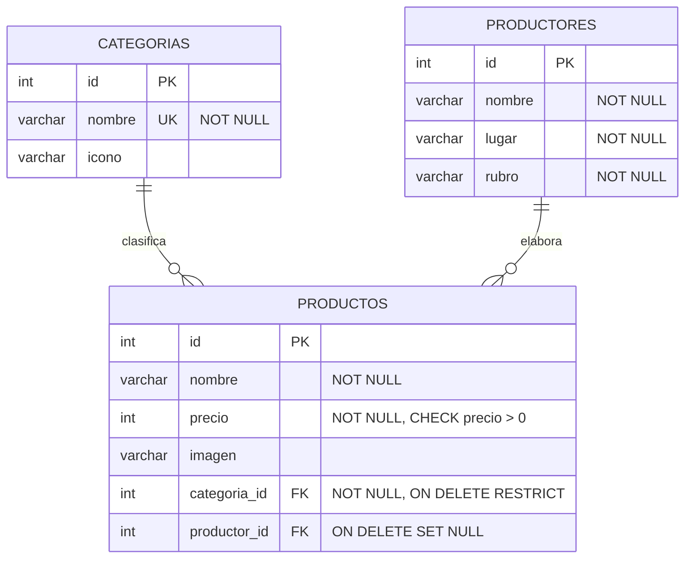

# VitrinaSur

Vitrina comercial territorial de Chiloé: catálogo web de productos locales, productores y categorías.

- **Asignatura:** Tecnologías Web y Móviles, 6° semestre, Ingeniería Civil en Informática, Universidad de Los Lagos
- **Frontend (producción):** <URL de Vercel>
- **Backend (producción):** <URL de Render>
- **Base de datos:** PostgreSQL gestionado en Neon

## Integrantes 

| Benjamin Alocilla |

| Bryan Carcamo |

## Tecnologías

| Capa | Tecnología |
|---|---|
| Frontend | React + Vite (SPA con React Router) |
| Backend | Node.js + Express 5 |
| Base de datos | PostgreSQL (driver `pg`, consultas parametrizadas) |
| Despliegue | Vercel (frontend), Render (backend), Neon (PostgreSQL) |

## Arquitectura N-capas

```
React (componente) ──► Ruta ──► Controlador ──► Servicio ──► Modelo ──► PostgreSQL
                                                                           │
React (estado)   ◄── JSON ◄── Controlador ◄── Servicio ◄── Modelo ◄───────┘
```

| Capa | Carpeta | Responsabilidad |
|---|---|---|
| Presentación / Rutas | `backend/routes` | Define los endpoints y los asocia a un controlador |
| Controladores | `backend/controllers` | Recibe `req`, llama al servicio y responde con el código HTTP |
| Lógica de negocio | `backend/services` | Valida datos, aplica reglas y lanza `AppError` (400, 404) |
| Acceso a datos | `backend/models` | Únicas consultas SQL, siempre parametrizadas (`$1, $2...`) |
| Transversal | `backend/utils/AppError.js`, `backend/index.js` | Errores esperados y manejo global centralizado de excepciones |

**Ejemplo de flujo real (crear producto):**
1. El formulario de `/agregar` valida los campos y envía `POST /api/productos`.
2. `productosRoutes` dirige la petición a `createProducto`.
3. `productosService.crear` valida nombre, precio y categoría, y obtiene o crea el productor (`buscarOCrear`).
4. `productosModel.crear` ejecuta `INSERT ... VALUES ($1..$5)` en PostgreSQL.
5. El servicio devuelve el producto con su productor y categoría, y el controlador responde `201` con JSON.
6. Si algo falla, el manejador global de `index.js` responde con el código correcto sin exponer trazas internas.

## Modelo de datos



- `UNIQUE (nombre, lugar)` en `productores` evita duplicados.
- `CHECK (precio > 0)` impide precios inválidos aunque se omita el frontend.
- `ON DELETE RESTRICT` protege las categorías con productos; `ON DELETE SET NULL` conserva el producto si se elimina su productor.
- Script completo: [`backend/database/schema.sql`](backend/database/schema.sql).

## API REST

Base: `<URL del backend>/api`

| Método | Ruta | Body / Parámetros | Respuestas |
|---|---|---|---|
| GET | `/health` | n/a | `200` estado de la API |
| GET | `/productos` | Query opcional: `q` (texto en el nombre), `categoria_id` | `200` lista; `400` filtro inválido |
| POST | `/productos` | `{ nombre*, precio*, categoria_id*, productor, lugar, imagen }` | `201` creado; `400` validación |
| PUT | `/productos/:id` | Mismo body que POST | `200` actualizado; `400` datos o id inválidos; `404` no existe |
| DELETE | `/productos/:id` | n/a | `200` eliminado; `400` id inválido; `404` no existe |
| GET | `/categorias` | n/a | `200` lista |
| GET | `/productores` | n/a | `200` lista |
| POST | `/productores` | `{ nombre*, lugar*, rubro* }` | `201` creado; `400` validación; `409` duplicado |

`*` = obligatorio. Errores con formato `{ "error": "mensaje" }`. Los errores de PostgreSQL por datos del cliente se traducen a 400 o 409 y los inesperados a `500` con mensaje genérico (el detalle solo va al log del servidor).

## Variables de entorno

Copiar `backend/.env.example` a `backend/.env` y `VitrinaSur/.env.example` a `VitrinaSur/.env`. **Nunca subir los `.env` al repositorio** (están en `.gitignore`).

| Variable | Dónde | Descripción |
|---|---|---|
| `PORT` | Backend | Puerto del servidor (3000 por defecto) |
| `NODE_ENV` | Backend | `development` o `production` |
| `DB_HOST`, `DB_PORT`, `DB_USER`, `DB_PASSWORD`, `DB_NAME` | Backend (local) | Conexión a PostgreSQL local |
| `DATABASE_URL` | Backend (producción) | Cadena de conexión de Neon (tiene prioridad sobre `DB_*`) |
| `FRONTEND_URL` | Backend | Origen permitido por CORS, sin `/` final |
| `VITE_API_URL` | Frontend | URL pública del backend, sin `/` final |

## Ejecución local

```bash
# 1. Base de datos: ejecutar backend/database/schema.sql en PostgreSQL
# 2. Backend
cd backend
npm install
npm run dev        # http://localhost:3000

# 3. Frontend (otra terminal)
cd VitrinaSur
npm install
npm run dev        # http://localhost:5173
```

## Seguridad

- Credenciales solo en variables de entorno; `.env` ignorado por Git y `.env.example` documentado.
- Consultas parametrizadas en todos los modelos (sin concatenación de SQL).
- Validación en servidor (servicios) y en cliente (formularios).
- CORS restringido al dominio del frontend en producción.
- Límite de tamaño del body (`100kb`) y respuestas de error sin trazas internas.

## Informe de co-creación y auditoría con IA generativa

**Herramientas utilizadas:** Claude (Anthropic). <agregar otras si corresponde: Copilot, ChatGPT, etc.>

**Uso declarado:** apoyo en la revisión de código, la refactorización a capas, el diseño del esquema SQL y la guía de despliegue. Las capturas de los prompts representativos están en el dossier técnico.

**Bitácora de auditoría humana** (problemas detectados y cómo se resolvieron):

| # | Problema detectado | Corrección aplicada |
|---|---|---|
| 1 | `db.js` solo soportaba variables `DB_*`: no conectaba a una base en la nube y no consideraba SSL | Se agregó soporte para `DATABASE_URL` con SSL en la cadena de conexión |
| 2 | `index.js` importaba rutas y utilidades que no existían (`productoresRoutes`, `utils/AppError`), por lo que el servidor no arrancaba | Se crearon los archivos faltantes |
| 3 | El controlador de productos mezclaba SQL, validación y respuesta HTTP | Refactor a Ruta → Controlador → Servicio → Modelo |
| 4 | Modelo desnormalizado: `productor` y `lugar` repetidos como texto en `productos` | Tabla `productores` con llave foránea y `buscarOCrear` |
| 5 | Faltaban restricciones de integridad | `CHECK (precio > 0)`, `NOT NULL` en `categoria_id`, `ON DELETE RESTRICT/SET NULL`, `UNIQUE` |
| 6 | Datos incoherentes: papas y cerveza estaban en la categoría Quesos | Nuevas categorías Agricultura y Bebidas |
| 7 | Error `42P01` (relación inexistente): el código nuevo corría sobre un esquema desactualizado | Se reejecutó `schema.sql` y se versionó en `backend/database` |
| 8 | <agregar los hallazgos propios del equipo> | <corrección> |

**Responsabilidad:** todo el código fue revisado, probado y es explicable por el equipo durante la defensa técnica.

## Limitaciones conocidas

- Las imágenes se empaquetan con el frontend (`src/assets`); un producto nuevo solo muestra imagen si el archivo ya existe en el repositorio. Mejora futura: almacenamiento externo (Cloudinary o Supabase Storage).
- El plan gratuito de Render duerme el servicio tras un tiempo de inactividad: la primera petición puede tardar unos segundos.
